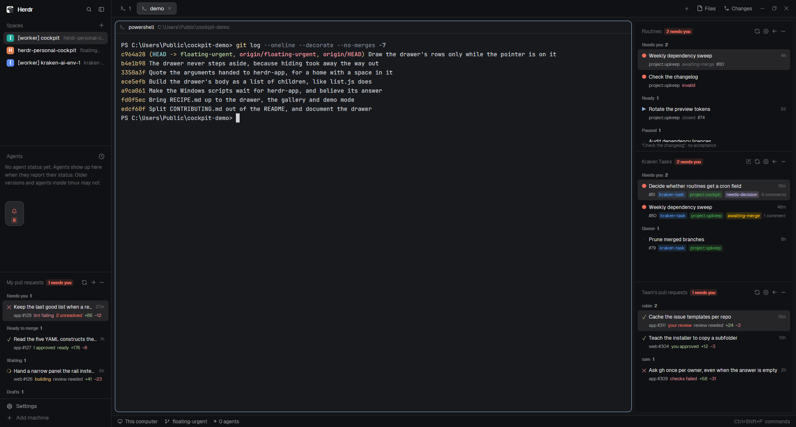

# Personal Cockpit

Panels for the [Herdr](https://herdr.dev) desktop app: what needs me, in the
sidebar, next to the agents doing the work.



| Panel | What it shows |
|---|---|
| **Pull requests** | Your open PRs across every repo you can read: build state, approvals, conflicts, unresolved threads, diff size. Grouped into Needs you / Ready to merge / Waiting / Drafts. |
| **Kraken Tasks** | The open issues of one coordination repo you choose — a [kraken](https://github.com/rafael-adcp/kraken) task queue. Grouped into Needs you / Queue, with the issues' own GitHub labels. |

Both keep their last good list when a refresh fails, minimise to their own
header bar, move to a column on the right, and drop to an icon-and-count rail
when the sidebar is dragged narrow.

`RECIPE.md` is the brief this was built from — read that to rebuild or change
it, and keep it current when you do. The files here are one build of it.

## Requirements

- Herdr 0.1.13 or newer.
- The [GitHub CLI](https://cli.github.com), signed in: `gh auth login`. It is
  the only way in — there is no token to configure. On Windows it does not need
  to be on your PATH; the known install paths are tried too.

## Install

From a clone of this repo. A junction rather than a copy, so editing here
hot-reloads in the running app; it needs no administrator, unlike a symlink on
a machine without Developer Mode.

```powershell
$herdr = "$env:USERPROFILE\.config\herdr-app"
New-Item -ItemType Junction -Path "$herdr\mods\personal-cockpit" -Target "$PWD\mods\personal-cockpit"
Copy-Item layouts\cockpit.json "$herdr\layouts\"
herdr-app do layout.switch --name cockpit
```

On macOS or Linux:

```sh
herdr=~/.config/herdr-app
ln -s "$PWD/mods/personal-cockpit" "$herdr/mods/personal-cockpit"
cp layouts/cockpit.json "$herdr/layouts/"
herdr-app do layout.switch --name cockpit
```

The layout is copied, not linked, because Herdr owns that folder — re-copy it
when it changes here. `ctrl-shift-l` cycles back to your own layout, and
`ctrl-alt-shift-escape` always returns to the default `main`.

To put the panels in a layout you already have, add two blocks to a column:

```json
{ "id": "pulls", "type": "block", "min": 42, "size": { "weight": 1 },
  "content": { "mod": "personal-cockpit", "props": { "kind": "pulls", "node": "pulls" } } },
{ "id": "kraken-issues", "type": "block", "min": 42, "size": { "weight": 1 },
  "content": { "mod": "personal-cockpit", "props": { "kind": "issues", "node": "kraken-issues" } } }
```

For the move button to have somewhere to go, the row holding your tab block
needs an empty `right-lists` column — or let the panel create one the first
time you press it.

## Choosing the repo Kraken Tasks watches

Click the gear in its header, or press `c` while the panel has the keyboard.
Type `owner/name`; anything the signed-in `gh` can read works, including a
private repo on an org. The repos you pick are remembered for one-click
switching.

The choice lives in `shared("cockpit.issues.repo")`, which Herdr keeps in that
machine's `shared.json`. **So each machine keeps its own** — the desktop can
watch `you/personal-tasks` while the work laptop watches `org/work-tasks`, with
no configuration beyond picking once on each.

To pin a block instead, name the repo in the layout and the gear disappears —
useful for showing two task panels at once:

```json
"props": { "kind": "issues", "node": "work-issues", "repo": "org/work-tasks" }
```

## Keys

Handled by the focused panel, no binding needed:

| Key | Does |
|---|---|
| `↑` / `↓` | move the selection |
| `enter` | open the selected row in the browser |
| `r` | refresh |
| `c` | choose the repository (Kraken Tasks) |

`pane.go` reaches the panels, so `ctrl-alt-<arrow>` or whatever you have bound
to it moves the keyboard onto one.

A binding in `keys.json` reaches **both** panels, because they are one mod:

```json
{ "mod:personal-cockpit": { "f5": "personal-cockpit.refresh" } }
```

No `keys.json` ships here, so nothing of yours is touched.

## Developing

```sh
herdr-app check mods/personal-cockpit   # must exit 0 before you call it done
herdr-app status                        # errors from layouts, keys and mods
herdr-app shot shot.png                 # the last rendered frame, as a PNG
```

`check` renders the mod once with no props, which is the pull requests panel.
To check another screen, force it at the top of `list.js` or `main.js`, run
`check`, and put it back.

`jsconfig.json` and `gpui-kit.d.ts` are written into the mod folder by the app
on every start and are deliberately not committed: the typings have to match
the installed version.

## Why one mod

The two panels began as two mod folders and shared about a third of their code
line for line — plus a second copy of every bug fix. Mods cannot import across
folders (`./relative` inside the folder is the limit), so the only way to share
is to be one mod, with the layout running it twice under different `props.kind`.
That is what the Herdr app's own `win98` does, and what `cockpit`, `redline` and
`claude-chat` do in the community.

`git log` has the before: the first commit is both panels exactly as they ran,
the second is the merge.

## Licence

MIT.
