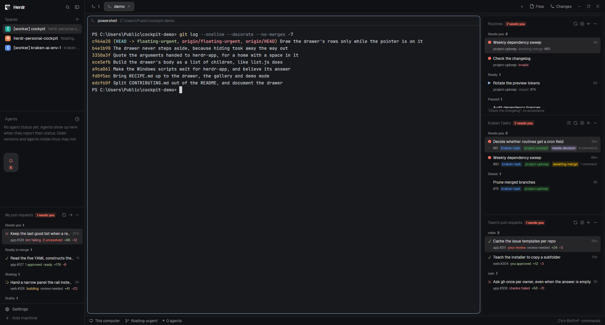

# Personal Cockpit

Stacked panels in the Herdr sidebar, under Spaces and Agents: your open pull
requests across every repo you can read, the open pull requests of the people
you watch, and the open issues of one coordination repo you pick — a kraken task
queue. Each says in its header how many want something from you, keeps its last
good list when the network blips, minimises to its own header bar, and can move
to a matching column on the right. Click a row to open it in the browser.

> This brief describes the pull request panels and Kraken Tasks. The Routines
> panel shipped without being written up here; `README.md` and the comments in
> `routines.js` are its documentation until someone backfills this file.



## What you see

The shipped `cockpit` layout is Herdr's `main` with four blocks added to
`sidebar-lists`, so the sidebar column reads top to bottom:

- **Brand** — 46 px, `workspace-chrome`, drags the window.
- **Spaces** — flexible, `min` 90.
- **Agents** — flexible, `min` 90.
- **My pull requests** — flexible, `min` 42.
- **Team's pull requests** — flexible, `min` 42.
- **Routines** — flexible, `min` 42.
- **Kraken Tasks** — flexible, `min` 42.
- **Footer** — 69 px, `workspace-chrome` with `footer: true`.

The sidebar is 268 px, `min` 44, `max` 480, background `chrome`, not resizable.
To its right the usual work column: a 42 px tab bar, the active tab with card
panes (radius 10, gap 8, 30 px always-on header, `lone: true`), a 28 px status
bar. In `work-body` sit two more columns, both `hidden` until used: `panel`
(Files and Changes, 368 px) and **`right-lists`** (380 px, `min` 300, `max`
640) — the empty column either panel moves into.

Each panel is the same shape:

- A **41 px header**: the title in 11.5 px `dim`, shrinking and truncating so
  that a long one gives way to the pill beside it rather than pushing the
  buttons off the end; then one of a red `blocked`
  pill reading `N needs you`, a 10.5 px `blocked` word naming trouble
  (`no repo`, `gh missing`, `sign in`, `no access`, `failed`, `stale`), or a
  plain 10 px `muted` count. Right-aligned, 13 px icons, 8 px apart: a
  pencil-square on Kraken Tasks only, then refresh (a `working` ring spinner
  while loading), a gear on Kraken Tasks only, dock-left/dock-right, and
  minus/plus. The pencil has a glyph of its own rather than a bare plus,
  because a collapsed panel shows it next to the plus that expands.
- A **list**, 6 px side padding, 1 px between rows, scrollbar on overflow.
  Group titles are 10 px semibold `dim` with a `muted` count beside them.
- Each **row** is 10 px × 5 px, radius 6, `hover` background, tooltip with
  everything the row truncated. Line one: an 11 px glyph cell, the title in
  12 px `foreground` truncating, and an age in 10 px `dim` (`now`, `6m`, `3d`).
  Wider than 220 px a second line appears, indented under the title by the same
  11 px cell, 10.5 px.

**My pull requests** groups into Needs you, Ready to merge, Waiting, Drafts. The
glyph is `✓` in `ansi2` when checks passed, `✕` in `ansi1` when they failed, a
spinning ring in `working` while they run, `·` in `dim` with no checks. The
second line is `repo #number`, then what is true of it most-pressing-first —
`conflicts`, `changes requested`, `N failing`, `N unresolved`, `building`,
`N approved`, `review needed`, `ready`, `behind base`, `no checks` — then
`+additions` in `ansi2` and `−deletions` in `ansi1`.

**Team's pull requests** is the same row, from a search instead of
`viewer.pullRequests`, and **grouped by the person who opened it**: one group
per login, the group head being the login and its count. The signals are
`your review` in `blocked` first, then `conflicts`, `changes requested`,
`checks failed`, `N unresolved`, `building`, and one of `you approved` /
`N approved` / `review needed`. The failing *job names* are not asked for —
on somebody else's PR they are not yours to chase, and they are what a page of
50 results would be expensive for.

**Kraken Tasks** groups into Needs you (any issue labelled `needs-decision` or
`awaiting-merge`) and Queue, each newest-updated first. The glyph is `●` in
`blocked` for the first group, `·` in `dim` otherwise. The second line is
`#number`, then the issue's own GitHub labels as badges in their own colours,
then `N comments`. A label colour too dark to read on the sidebar is lifted
toward white in 25% steps until its relative luminance clears 0.45; the hue is
kept.

Narrower than 160 px either panel drops to a **rail**: its icon, tinted
`blocked` when something needs you, and the count in a small pill.

## How it behaves

- **Refresh.** My pull requests every 180 s, Team's every 120 s, Kraken Tasks
  every 60 s, all of them on the refresh icon and on `r` while the panel holds
  the keyboard. A refresh already running is not started again. The icon's
  tooltip names the signed-in login (my pull requests), how many people are
  watched or the query itself (team), or the watched repo (tasks), and when it
  last succeeded.
- **A failed poll keeps the list.** If a refresh fails while a good list is on
  screen, the list stays, the header says `stale`, and a 10 px `dim` footer
  reads `Couldn't refresh · showing 6m ago` with the error as its tooltip. Only
  a failure with nothing to fall back on replaces the list.
- **Setup instead of an empty box.** `gh` missing offers Install gh (a terminal
  tab running `winget install --id GitHub.cli -e`; macOS and Linux get the
  one-liner as text). Not signed in offers Sign in (`gh auth login` in a tab).
  No repo chosen offers Choose repository. No access offers Choose another.
  Any other failure offers Try again.
- **Choosing the repo.** The gear, or `c` with the keyboard, opens a 420 px
  dialog: a text field taking `owner/name`, the repos picked before (each with
  a `✕` to forget it), and suggestions from `gh repo list` — of your own
  account, or of the owner you have typed so far, looked up 350 ms after you
  stop typing. Enter or Watch it saves; Esc or Cancel closes. A typed
  `owner/name` is always accepted whether or not it was suggested.
- **The choice is per machine.** It lands in `shared("cockpit.issues.repo")`,
  which Herdr keeps in that home's `shared.json` — so one machine watching
  `you/personal-tasks` and another watching `org/work-tasks` need no
  configuration beyond picking once on each. Setting it re-renders every mod,
  and the panel reloads within the same frame, cache first.
- **A panel configured by a file.** Team's pull requests is a search, and
  Routines is a list of tasks; both come from a YAML file in the *installed* mod
  folder (`conf.js`), which the installers exclude so an edit lands on the next
  poll with no reinstall. The gear opens it — writing it from the
  `*.example.yml` beside it when it is absent, so the gear never hands the
  desktop a path with no file at it. Which is also why the footnote is drawn
  under an *empty* list and not only under a full one: a panel configured by a
  file is usually empty because of that file, and the footnote is where the
  file's problems are said.
- **Keyboard.** With the panel focused (`pane.go` reaches it, `focusable` is
  true): `↑`/`↓` move a selection that draws with the `selected` background,
  `enter` opens it, `r` refreshes, `c` opens the repo dialog or the config file.
- **New task.** The pencil, `n` with the keyboard, or the button that appears
  under "No open tasks", opens the watched repo's new-issue form in the
  browser. Which form is resolved against the templates the repo really has:
  `task.yml` wins when present — kraken installs its issue form at exactly
  `.github/ISSUE_TEMPLATE/task.yml` (`workflow.py` maps it there, and the
  conformance test asserts that destination), so it is taken even with other
  forms beside it, a bug report not being a kraken task. Failing that: a lone
  template whatever its name, else `/issues/new/choose`, else a blank
  `/issues/new`. The template list is fetched once per repo per run, not per
  poll. `props.template` overrides the lot. Pull requests has no such button:
  a PR comes from a branch, not a form.
- **Click** opens the row in the system browser (`cx.open_url`). GitHub stays
  the place to act on a PR or an issue; this is the "what needs me" view.
- **Minimise** resizes the block to 42 px — the header bar and nothing else, so
  there is still something to click. The height it had is remembered in
  `shared("cockpit.<panel>.height")` and given back on expand; a block never
  dragged gets `weight: 1` instead. Dragging the divider below 60 px counts as
  minimised however it happened.
- **Move** rewrites the layout tree through `layout.set`: the panel goes to the
  column holding the `spaces` mod, or to `right-lists`, which is created inside
  the row holding the tab block if it is missing. An emptied `right-lists` is
  hidden rather than removed, so it keeps the width it was dragged to. Each
  side keeps its own size. The button hides when the layout has nowhere to go.

## Built from

```
layouts/cockpit.json          main + four blocks in sidebar-lists
layouts/cockpit.svg           its thumbnail in Settings, named by "preview"
mods/personal-cockpit/
  main.js      the one exported View; picks a screen by props.kind
  list.js      the list panel: state, refresh, setup states, keyboard, render
  picker.js    the repo dialog
  kit.js       header, rail, row, section head, badge, button, spinner, shell,
               checkGlyph/RED/RUNNING, minimise, moveTo,
               find/parentOf/destinations/placeOf, hostBlockFor, WIDE 220,
               COLLAPSED 42, COLLAPSED_MAX 60, RAIL_MAX 160,
               RIGHT "right-lists"
  github.js    gh discovery, graphql(), rest(), createIssue(), repoList(),
               issueTemplates(), viewer(), ago(), agoShort(), and the typed
               error kinds
  config.js    repoOf / choose / recent / forget, and the precedence
  conf.js      the YAML config file of a panel: pathOf, read, openFile
  yaml.js      the five-construct YAML reader those files are written in
  pulls.js     the GraphQL query, shaping, grouping and row for your PRs
  team.js      the search, searchFor(), shaping, grouping by person, and row
  issues.js    the REST call, slimming, cache, grouping and row for issues
  routines.js  the routines file, the marker, the ▶ that opens a task
  mod.json     { place: "none", title: "Cockpit", focusable: true,
                 overlay: { kind: "dialog", width: 420 } }
  *.svg        pulls, team, issues, routines, refresh, plus, minus, dock-left,
               dock-right, settings, new-task
  *.example.yml  routines and team, seeded on install and by the gear
```

One mod, eleven modules. Four layout blocks point at it with
`props: { kind: "pulls" | "team" | "routines" | "issues", node: "<block id>" }`,
and it opens its own dialog with `openOverlay({ mod: "personal-cockpit", props:
{ kind: "repo-picker", panel, current } })` — which is why the dialog needs no
mod folder of its own.

**Shipped mods used:** `spaces` and `agents` (the layout), `workspace-chrome`
(brand, footer, and its `spinner.svg`), `tabs`, `pane`, `files`, `changes`,
`workspace-status`.

**`herdr` functions:** `exec`, `layout`, `run`, `props`, `shared`, `setShared`,
`theme`, `openOverlay`, `closeOverlay`, `nextCommand`, `appHome`,
`readTextFile`, `writeTextFile`, `window`.
**Commands:** `layout.resize`, `layout.set`, `terminal.open`.
**Programs:** `gh` — `api graphql`, `api repos/…/issues`,
`api repos/…/contents/.github/ISSUE_TEMPLATE`, `repo list`, `auth login`,
`--version`; and one of `cmd /c start` / `open` / `xdg-open` for the config
file. Nothing else. The only write to GitHub is the one a routine's `▶` makes:
New task opens a browser and does not file the issue, and the team panel never
writes at all.

**GraphQL cost.** Measured with `rateLimit { cost }`, not counted by hand: the
team panel's `search(first: 50)` costs **2** points on a full page of 50
results, against a budget of 5,000 an hour — ~60 an hour at 120 s.
`viewer.pullRequests(first: 30)` measured **1** at one open PR. Counting child
nodes suggests an order of magnitude more than either; GitHub charges per
connection it has to go and fetch, not per node it returns. Measure again before
adding a connection to one of these, and do not estimate.

## Watch out

- **Install the mod folder as a copy, never a junction or a symlink.** The
  JavaScript loads fine through a link, so the panels come up and look right —
  but `svg("mods/personal-cockpit/…")` then resolves outside
  `~/.config/herdr-app` and every icon silently draws nothing. The headers lose
  refresh, gear, dock and minimise, `herdr-app status` stays clean, and there
  is no error anywhere to follow. Established by A/B on 0.1.13: same commit,
  same layout, junction → bare headers, copy → all four buttons. The shipped
  `mods/workspace-chrome/spinner.svg` keeps working throughout, which is the
  tell — it is the one asset that does not come from the linked folder.
  `tools/install.ps1` copies, on purpose.
- **`gh` is often not on Herdr's PATH on Windows.** Herdr's environment is the
  one it started with, and the gh installer does not touch a running process.
  `github.js` tries `gh` and then five known install paths, including
  `C:\Program Files\GitHub CLI\gh.exe` — this is load-bearing, not belt and
  braces. Remove it and the panel reports gh missing on a machine that has it.
- **One mod means one key namespace.** `keys.json` sections are `mod:<name>`,
  and `<mod>.<command>` is delivered to *every shown copy* — so
  `personal-cockpit.refresh` refreshes both panels, and there is no way to bind
  a key to only one of them. The in-panel `on_key_down` keys (`r`, `c`, arrows,
  enter) do go to just the focused panel. This is the price of the two panels
  sharing their code; it was a deliberate trade.
- **Don't discover the host block by mod name.** Two blocks run this mod, so
  `content.mod === "personal-cockpit"` matches both. `hostBlockFor` goes by
  `content.props.kind`, with `props.node` winning when the layout states it.
- **Hardcoded node ids break when a layout renames them.** An earlier version
  of the tasks panel wrote the layout file directly and looked for
  `sidebar-lists` by name. `kit.destinations` finds the sidebar as "the node
  holding the `spaces` mod" and the work row as "the node holding the `tab`
  block" instead, so a differently-shaped layout degrades to hiding the move
  button rather than throwing.
- **A layout file can change under you.** The old dock button rewrote
  `layouts/<name>.json`, which reorders blocks. Anything that edits the tree
  must address blocks by id, never by index.
- **GitHub answers 404, not 403, for a private repo your token cannot see.**
  "No access" and "no such repo" are the same response; the panel says so
  rather than guessing.
- **`mergeStateStatus` sits behind a preview media type.** The query asks with
  the `merge-info-preview` Accept header and retries once without the field if
  the preview is gone. Everything else on the row survives without it; only
  "Ready to merge" gets less precise, falling back to an approval.
- **The issues endpoint returns pull requests too.** They are filtered on
  `pull_request` being absent.
- **And `search(type: ISSUE)` returns issues, whatever `is:pr` said.** An Issue
  node has none of the fields asked for inside `... on PullRequest` and arrives
  as `{ "__typename": "Issue" }`, so the filter is on the typename. Verified
  against `repo:cli/cli is:open`, which answers with both.
- **`@me` is not a search qualifier.** It is a gh and web shorthand; the API
  does not expand it, which is why `pulls.js` avoids `author:@me` and takes
  `viewer.pullRequests` instead. `team.js` does expand it, by hand, against the
  login from `viewer()` — so a `team.yml` written with `review-requested:@me`
  works and one read by anything else would not.
- **GitHub caps a search query at 256 characters.** A watch list long enough to
  pass it gets a message with the length in it; over the wire that is a
  `422 Validation Failed` naming nothing. Past a handful of people, an `org:`
  scope is the answer rather than more `author:` terms.
- **Don't let a config panel's trouble land only in the footnote of a
  non-empty list.** "Nothing to watch" and "that is not a login" are exactly
  the cases with no rows to draw, and the footnote used to be inside the
  has-rows branch — so the one panel state that most needed a reason had none.
- **The YAML reader takes `- name` as well as `- key: value`.** `people:` is a
  list of names, `routines:` a list of maps, and one flat `items` carries both;
  an item is a string or an object. A routine that lost its `title:` therefore
  arrives as a string rather than as a parse error, and `validate` is what
  reports it.
- **Suggestions in the picker are not the way in.** `gh repo list` only knows
  the account signed in right now, so a repo on a work account or an org may
  never appear. The text field always accepts a typed `owner/name`.
- **`props.repo` pins a block and hides the gear.** A layout that names a repo
  meant that block to be that repo; use it to show personal and work side by
  side, and expect no picker on those.
- **Two different pictures, easy to confuse.** `preview.png` at the repo root
  is the herdr.dev gallery card and the README image. `layouts/cockpit.svg` is
  the thumbnail inside the app, in Settings → Look, and it only appears
  because the layout root names it in `"preview"`. Herdr draws its own
  thumbnails for its own layouts, so a layout from elsewhere with no `preview`
  is the only one in that row showing an empty frame.
- **The installer has to copy the `.svg` too.** It is referenced from the
  layout, not from the mod, so a run that copies only `cockpit.json` leaves
  `"preview"` pointing at a file that is not in the Herdr home. Both scripts
  loop over `cockpit.json` and `cockpit.svg`.
- **`props.kind` is the only thing telling four copies apart.** A new panel is a
  module with the source interface (`panel`, `title`, `icon`, `load`,
  `sections`, `attention`, `rowOf`, and whichever of `configure`, `footnote`,
  `stampNote`, `newUrl`, `act`, `cached`/`save` it needs), one line in
  `SOURCES` in `list.js`, and a block in the layout. `panel` names the block,
  the remembered height and the cache — it is not the title, which is why
  renaming "Pull requests" to "My pull requests" left `panel: "pulls"` alone.
- **The cache is per mod copy.** `localStorage` lands in
  `data/personal-cockpit/store-<hash>.json`, hashed from the props — so two
  blocks, or the same block with a different repo, do not share one. It is
  keyed by repo inside as well.
- **Only `gh` is checked at startup, not the repo.** A repo you cannot see is
  found out on the first call, which is what the `not-found` state is for.

## Done when

- Every panel draws in the sidebar with the `cockpit` layout, each with its own
  header and count.
- **Every header button is visible**: My pull requests shows refresh, dock and
  minimise; Team's pull requests and Routines add a gear; Kraken Tasks adds a
  gear and a pencil. An icon that does not draw means the mod was linked
  instead of copied — check this before anything else, because nothing else
  reports it.
- `herdr-app check mods/personal-cockpit` exits 0 — and again with each of
  `team`, `routines` and `issues` forced as the default source at the top of
  `list.js`, since `check` renders with no props and that is only ever one of
  the four screens.
- With no `team.yml`, Team's pull requests says `no team.yml yet` and the gear
  writes one from the example and opens it.
- With the freshly-seeded `team.yml`, whose settings are all commented out, the
  panel says `nothing to watch: set query or people in team.yml` — under the
  empty list, not swallowed by it.
- With a `query` and two `people`, the panel shows a group per login in the
  order the file lists them, a third group for anyone else the query found, and
  `your review` on a PR that has you as a requested reviewer.
- A `people:` entry that cannot be a login is named in the footnote and left
  out of the query; the rest of the list still loads.
- Forty people in the file gives the 256-character message, before any call.
- With `gh` renamed away, the panel says `gh missing` and offers Install gh.
- With `gh` present but signed out, it says `sign in` and offers Sign in.
- The gear opens the dialog; typing `owner/name` of a repo you can read and
  pressing Enter replaces the list without a restart, and the repo appears
  under Recent next time.
- Typing a repo you cannot read gives `no access` and a Choose another button.
- Dragging the sidebar below 160 px turns both panels into rails with their
  counts; widening restores the rows.
- Minus collapses a panel to a 42 px header; plus returns it to the height it
  had.
- The dock arrow moves a panel into the right column, which appears at 380 px;
  moving the last one out hides the column but keeps its width.
- Killing the network mid-refresh leaves the rows on screen with `stale` in the
  header, not an empty panel.
- `↑`/`↓` move the selection in both panels and `enter` opens the selected row
  in the browser.
- The pencil on Kraken Tasks opens `…/issues/new?template=task.yml` for the
  watched repo, and Pull requests has no pencil at all.
- Pointed at a repo with no issue templates, New task still works and lands on
  a blank new-issue form.
- Settings → Look shows a drawn thumbnail on the cockpit card, not the empty
  frame a layout without a `preview` gets.
